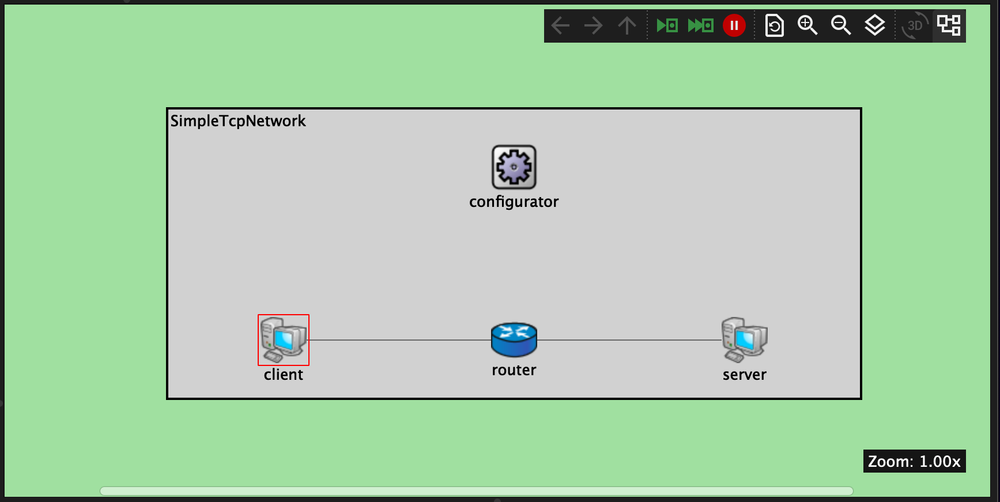
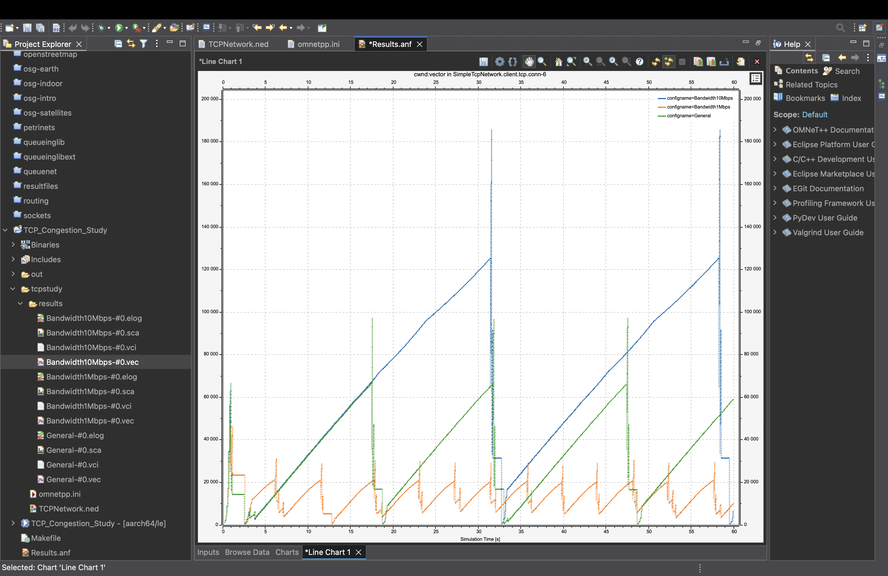
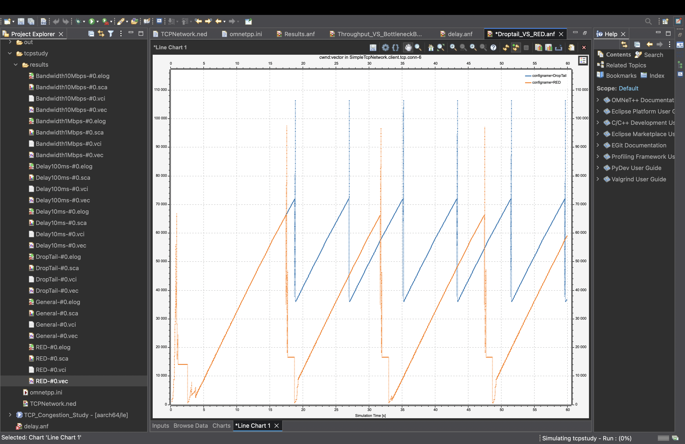

# TCP Congestion Control and Bottleneck Analysis (OMNeT++)

**Course project · Communication Networks · OMNeT++ / INET / Wireshark**

An experimental study of **TCP congestion control** in a simple client–router–server topology using **OMNeT++ with INET**. The project varies bottleneck capacity, link delay, and queue-management policy, and compares the effects on TCP's congestion window, round-trip time, and throughput. A complementary Wireshark exercise examines a real TCP/HTTP exchange.

## Experiments

| Variable | Configurations in supplied `omnetpp.ini` |
| --- | --- |
| Bottleneck bandwidth | `1 Mbps`, default `5 Mbps`, `10 Mbps` |
| Bottleneck propagation delay | `10 ms`, default `50 ms`, `100 ms` |
| Queue policy | DropTail vs. RED |
| TCP variant | Reno baseline; separate NewReno configuration |

The default simulation lasts **60 seconds** and sets up a TCP session sending **50 MiB** through the bottleneck link.

## Selected results

The figures illustrate how bottleneck constraints and queue policy change TCP's congestion-window dynamics. These are **course simulation results**, not benchmarks of a production network.

## Repository contents

- `Omnet Files/omnetpp.ini` — simulation parameters and experiment configurations
- `Omnet Files/TCPNetwork.ned` — topology definition (`tcpstudy.SimpleTcpNetwork`)
- `Omnet Files/anf Files/` — OMNeT++ analysis/chart configurations
- `Images/` — topology, Wireshark, RTT and CWND visualizations
- `docs/report-redacted.pdf` — project report with student-number information removed

## How to run

1. Install **OMNeT++** and a compatible version of the **INET framework**.
2. Create an OMNeT++ project and make INET available as a referenced project.
3. Import the supplied NED file and `omnetpp.ini`; make sure your project's **NED source folders and package** resolve `tcpstudy.SimpleTcpNetwork`.
4. Select a configuration in OMNeT++ (`Bandwidth1Mbps`, `Bandwidth10Mbps`, `Delay10ms`, `Delay100ms`, `DropTail`, `RED`, or `TcpNewReno`) and run it.
5. Inspect vector/scalar results and compare with the saved screenshots and `.anf` analysis files.

**Compatibility note:** The original OMNeT++/INET versions and complete IDE project metadata were not included in the upload. Some NED/INET settings may require updating before the project runs on your local installation.

## Data publication note

The original archive included a compressed `.pcapng` capture. It is **not included in this public-ready copy** because unreviewed packet captures can disclose network endpoints or traffic. The Wireshark screenshot and project report remain available for context.

**Author:** Sina Hemmati · B.Sc. Electrical Engineering (Telecommunications), K. N. Toosi University of Technology.
